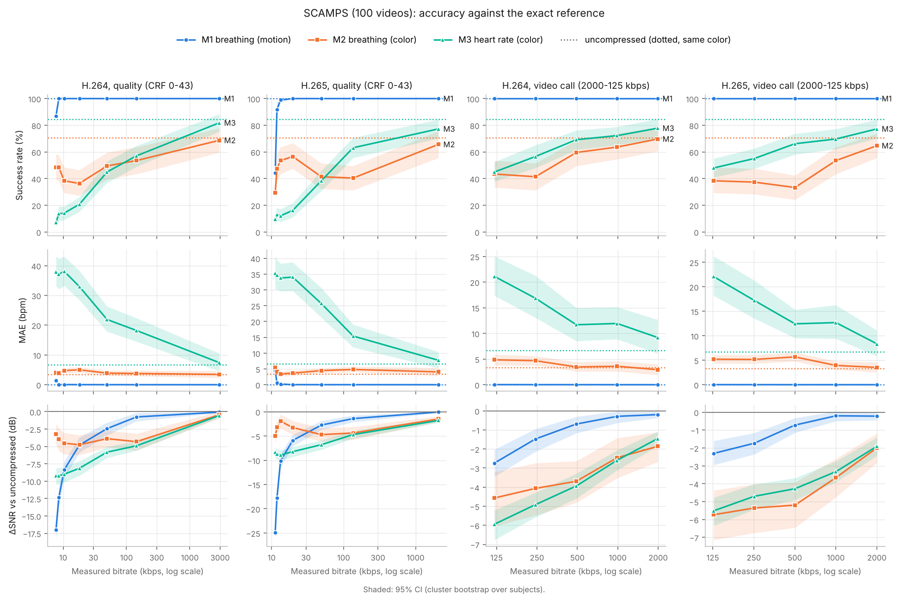
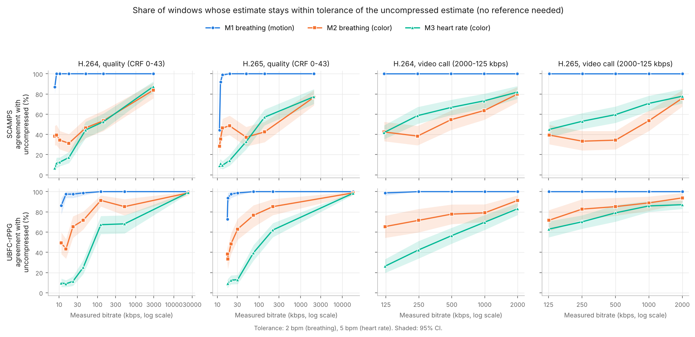
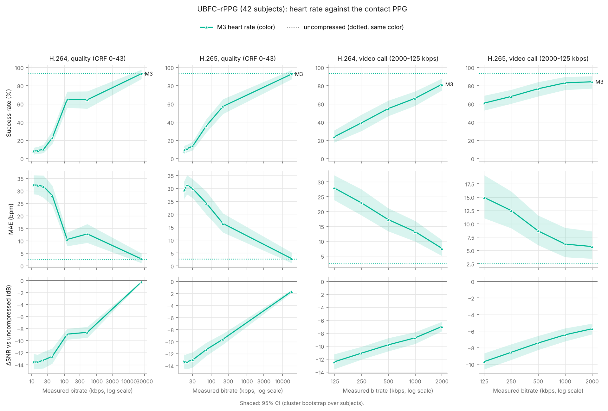
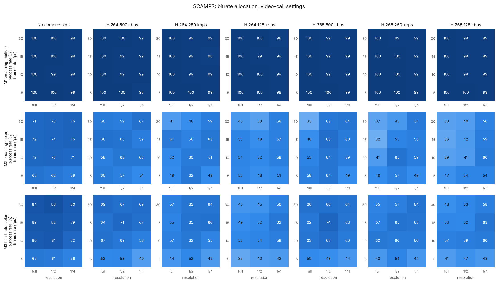
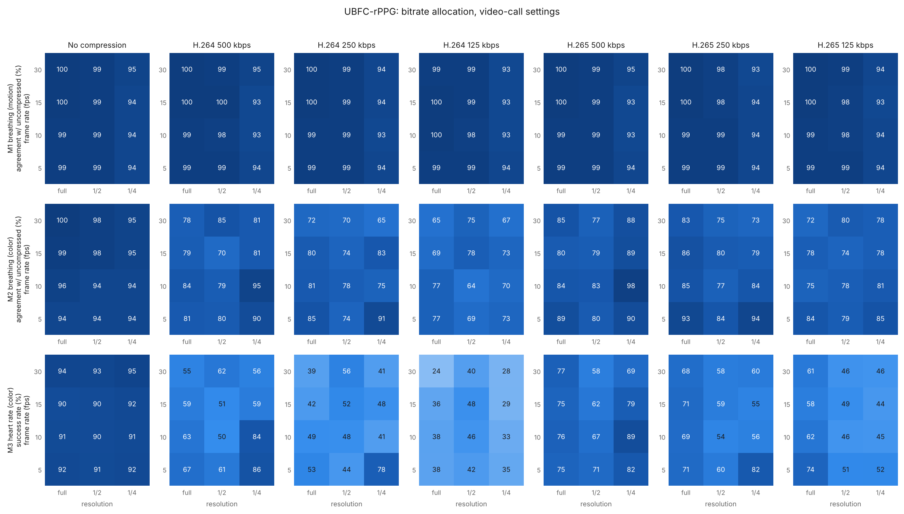

# 阶段 4：压缩实验

本文件回答 Q1–Q3，并给出阶段 5 的建议。数字都来自下面这些目录：

- 四个实验 run：`results/20261123_scamps_ladders_s0/`、`results/20261123_ubfc_ladders_s0/`、`results/20261123_scamps_allocation_s0/`、`results/20261123_ubfc_allocation_s0/`；
- 分析结果 `results/20261125_phase4_analysis/`：由 `analysis/compression_analysis.py` 从上面四个 run 的 `items.jsonl` 和 `metrics.json` 算出，包括 `analysis.json`（全部数字）、`tables.md`（同样的数字排成表）和 `figures/`。

方括号是按受试者 bootstrap 的 95% CI；`*` 表示 CI 不含 0。成功指误差在 ±2 次/分（呼吸）或 ±5 次/分（心率）以内。

## 1. 结论

1. **Q1：用肩部运动测呼吸（M1）极其抗压缩。**
   - SCAMPS 上，x264 一直压到 CRF 38（中位码率 9 kbps），成功率仍是 100%；只有最差的 CRF 43 才失灵（8 kbps，降到 86.9%）。x265 在 CRF 43（11 kbps）失灵。两条视频通话阶梯一直到 125 kbps 都没有失灵。
   - UBFC 没有可靠的呼吸参考，只能看「压缩后的估计和未压缩时是否一致」：两条视频通话阶梯一直到 125 kbps 都在 98.8% 以上；x264 CRF 33（23 kbps）还有 97.5%。
   - 用脸部颜色测呼吸（M2）则在第一档有损压缩（CRF 18，约 140 kbps）就失灵了。
2. **Q2：先失灵的是颜色信号，不是快信号。**
   - 同样测呼吸，颜色（M2）比运动（M1）早失灵得多：信号类型是主因。
   - 同样是颜色，SCAMPS 上的慢信号（M2 呼吸）和快信号（M3 心率）在 CRF 阶梯上都在 CRF 18 失灵，频率不是决定因素。
   - UBFC 上 M2 比 M3 稳定，但 M2 在 UBFC 上测到的可能不是呼吸（`notes/03-baseline.md` 第 5 节），所以「慢的颜色信号更抗压缩」这一点在真人上下不了结论。
3. **Q3：码率怎么分配，对运动测呼吸无所谓，对颜色测量取决于编码器。**
   - M1 在所有帧率、分辨率和码率的组合里都没有变化。
   - 颜色测心率（M3）在 UBFC 上：用 H.264 时，降分辨率显著更好（125 kbps 时同时减半帧率和分辨率，成功率 +23.8 个百分点）；用 H.265 时，降分辨率反而显著更差（−9.7 到 −18.5 个百分点）。只降帧率在两个数据集上都没有显著影响。
   - 所以「少帧但清楚更适合测呼吸」这个假设，在这个码率范围内没法检验：运动测呼吸在哪种分配下都不失灵，没有可以改进的余地。
4. **同样的码率，H.265 对心率明显更友好**：UBFC 上 125 kbps 时，x264 的心率成功率只有 23.8%，x265 有 60.9%。
5. **阶段 5 的建议**：针对颜色测量（心率）做压缩增强训练的深度模型（第 7 节）。

## 2. 数据和方法

| run | 视频 | 设置 | 版本 | 错误 |
|---|---|---|---|---|
| SCAMPS 阶梯 | 100 段（P000001–P000100） | 25 | 2500 | 0 |
| UBFC 阶梯 | 42 人 | 25 | 1050 | 0 |
| SCAMPS 码率分配 | 100 段 | 84 | 8400 | 0 |
| UBFC 码率分配 | 42 人 | 84 | 3528 | 0 |

- 所有压缩版本都只有一个关键帧（四个 run 的 `metrics.json` 里 `encoded_versions_with_more_than_one_keyframe` 都是 0）。
- 中途有几段 UBFC 视频从 Drive 拷贝时出现 I/O 错误，重跑后全部补齐；最终每个 run 都没有错误记录。
- 横轴用**实测码率**（每个设置各段视频的中位数）。同样的 CRF，两个数据集的码率差别很大：例如 x264 CRF 23，SCAMPS 是 49 kbps，UBFC 是 123 kbps。合成画面更容易压缩。

除了协议里的指标，分析时多算了两样东西，都只用已有的记录，不改协议：

- **和未压缩时的一致性**：一个窗口压缩后的估计，和同一窗口未压缩时的估计相差在容差以内，就算一致。它不需要参考值，所以 UBFC 的 81 个呼吸窗口都能用上（按协议，只有 12 个窗口有可用的参考）。阶段 4 记录了没有参考的窗口的估计值，就是为了这一步。缺点是：一直稳定地测错，也算「一致」。
- **码率分配的事先选定的对比**：同一编码器、同一码率下，「只减半分辨率」「只减半帧率」「两个都减半」分别减去「全帧率、全分辨率」，在同一批窗口上配对比较。从 12 个格子里挑最好的一个会有乐观偏差，所以结论以这三个固定对比为准，最好的格子只作参考。

## 3. Q1：压缩对测呼吸的影响

SCAMPS 上三条测量的成功率（%），来源：`tables.md` 的「Ladders, SCAMPS」：

| 设置 | 中位码率（kbps） | M1 运动测呼吸 | M2 颜色测呼吸 | M3 颜色测心率 |
|---|---|---|---|---|
| 未压缩 | – | 100.0 | 70.7 | 84.3 |
| x264 CRF 18 | 144 | 100.0 | 53.5 | 57.1 |
| x264 CRF 38 | 9 | 100.0 | 48.5 | 13.6 |
| x264 CRF 43 | 8 | 86.9 | 48.5 | 7.1 |
| x265 CRF 43 | 11 | 44.4 | 29.3 | 9.6 |
| x264 125 kbps | 121 | 100.0 | 43.4 | 44.9 |
| x265 125 kbps | 127 | 100.0 | 38.4 | 48.0 |

失灵点（`tables.md` 的「Breakdown points」）：

| 阶梯 | M1 | M2 | M3 |
|---|---|---|---|
| x264 CRF | CRF 43（8 kbps） | CRF 18（144 kbps） | CRF 18（144 kbps） |
| x265 CRF | CRF 43（11 kbps） | CRF 18（136 kbps） | CRF 18（136 kbps） |
| x264 码率 | 未失灵 | 250 kbps | 1000 kbps |
| x265 码率 | 未失灵 | 1000 kbps | 1000 kbps |

- **M1 的信噪比在下降，但还没影响到估计**：x264 CRF 38 时 M1 的 ΔSNR 已经是 −12.4 dB，但成功率仍是 100%。合成画面没有噪声，未压缩时 M1 的信噪比有 30.7 dB（`results/20261122_scamps_baseline_s0/summary.md`），余量很大。真人视频的余量要小得多，所以真人上 M1 失灵得会更早。
- **UBFC 上的 M1**：12 个有可用参考的窗口里，各档都没有失灵，但这 12 个窗口的参考本身可疑，不能当证据。改看一致性（下图第二行）：M1 在 x264 CRF 28（43 kbps）时还有 98.8%，CRF 43（11 kbps）时降到 86.4%；x265 CRF 43（17 kbps）时降到 72.8%。和 SCAMPS 一样，只有最极端的几档才明显变差。

## 4. Q2：呼吸和心率谁更抗压缩，为什么

同一批视频上，三条测量在两个典型压缩点的变化（相对未压缩的配对差值；来源：`tables.md`）：

| 数据集 | 设置 | 指标 | M1 运动测呼吸 | M2 颜色测呼吸 | M3 颜色测心率 |
|---|---|---|---|---|---|
| SCAMPS | x264 CRF 18 | Δ 成功率（百分点） | 0.0 | −17.2* | −27.3* |
| SCAMPS | x264 CRF 18 | Δ 信噪比（dB） | −0.8* | −4.3* | −4.9* |
| SCAMPS | x264 125 kbps | Δ 成功率 | 0.0 | −27.3* | −39.4* |
| SCAMPS | x264 125 kbps | Δ 信噪比 | −2.7* | −4.6* | −5.9* |
| UBFC | x264 CRF 18 | 一致性（%） | 100.0 | 85.2 | 68.1 |
| UBFC | x264 125 kbps | 一致性 | 98.8 | 65.4 | 26.2 |

拆开两个因素：

- **信号类型（M1 对 M2，都测呼吸）**：差别巨大。轻度压缩时运动信号的信噪比几乎不变，颜色信号就掉了 4 dB 以上。这符合压缩的原理：编码器先丢掉幅度很小的颜色细节，而运动是画面结构的整体移动，被当成运动矢量保留下来。
- **频率（M2 对 M3，都是颜色）**：
  - SCAMPS 上两者的信噪比下降差不多（CRF 18 时 −4.3 对 −4.9 dB），CRF 阶梯上都在 CRF 18 失灵。频率不是主要因素。
  - UBFC 上 M2 的一致性明显高于 M3（125 kbps 时 65.4% 对 26.2%）。但 `notes/03-baseline.md` 第 5 节发现，UBFC 上 M2 测到的大多是每分钟 6–12 次的慢波动，可能不是呼吸。这种幅度较大、很慢的变化本来就更容易被保留下来，所以这条差别说明不了「呼吸频率的颜色信号更抗压缩」。
- **结论**：压缩伤害的主要是颜色信号；呼吸之所以比心率抗压缩，是因为可以用运动来测，而不是因为呼吸慢。按 GUIDE 第 9 节的要求，这个方向在 SCAMPS 和 UBFC 上一致（UBFC 用一致性）。

UBFC 上心率对参考的结果（42 人，参考可靠）：

- 失灵点：x264 CRF 18（513 kbps）、x265 CRF 18（215 kbps）、x264 2000 kbps、x265 1000 kbps。
- 即使在 2000 kbps，x264 的心率信噪比也下降了 7.0 dB，成功率下降了 12.1 个百分点。640×480 的真人视频比合成画面需要多得多的码率。
- **编码器**：视频通话设置下，x265 在每一档都好于 x264（125 kbps 时成功率 60.9% 对 23.8%）。SCAMPS 上两者差不多（44.9% 对 48.0%），可能是因为合成画面太容易压缩，两种编码器都还没到瓶颈。

## 5. Q3：码率怎么分配

- **M1**：SCAMPS 上 72 个压缩格子的成功率都在 98–100%；UBFC 上一致性只在 1/4 分辨率时降到 92–95%，而不压缩、只缩小到 1/4 时也是 93.8–95.1%，所以这是分辨率本身的影响，不是压缩。
- **事先选定的三个对比**（相对全帧率、全分辨率，成功率的百分点；只列至少有一个显著差别的行，全部见 `tables.md`）：

  | 数据集 | 编码器 | 码率 | 测量 | 只减半分辨率 | 只减半帧率 | 两个都减半 |
  |---|---|---|---|---|---|---|
  | UBFC | x264 | 500 | M3 | +7.3* | +4.4 | −4.0 |
  | UBFC | x264 | 250 | M3 | +16.5* | +3.2 | +12.5* |
  | UBFC | x264 | 125 | M3 | +16.1* | +12.5* | +23.8* |
  | UBFC | x265 | 500 | M3 | −18.5* | −2.0 | −14.5* |
  | UBFC | x265 | 250 | M3 | −9.7* | +2.4 | −9.3* |
  | UBFC | x265 | 125 | M3 | −14.5* | −2.8 | −12.1* |
  | SCAMPS | x264 | 250 | M2 | +7.1 | +19.2* | +14.1* |
  | SCAMPS | x265 | 500 | M2 | +28.3* | +15.2* | +34.3* |
  | SCAMPS | x265 | 250 | M2 | +6.1 | −5.1 | +17.2* |
  | SCAMPS | x265 | 250 | M3 | +2.0 | +1.5 | +9.6* |

- **H.264 和 H.265 方向相反**：用 H.264 时，把码率集中到更少的像素上（降分辨率）对颜色测量有利；用 H.265 时，保持全分辨率更好。可能是 H.265 在全分辨率下压缩效率已经足够，而在小画面上它的大编码块会把脸部的颜色抹平；这一点我没有验证。
- **只降帧率**：UBFC 心率上，除了 x264 125 kbps（+12.5），都没有显著变化。SCAMPS 上它在两处显著改善了颜色测呼吸（x264 250 kbps +19.2，x265 500 kbps +15.2），其余不显著。
- **帧率本身的代价**：不压缩、只降到 5 帧/秒时，SCAMPS 的心率成功率从 84.3% 降到 62.1%。5 帧/秒的奈奎斯特频率只有 2.5 Hz，按协议心率频段上限降到 2.375 Hz（142.5 次/分），而 SCAMPS 的心率最高到 150 次/分。
- **每像素的码率能解释一部分**：在两个数据集的全部压缩设置上，颜色测量的一致性和「每像素比特数」（码率 ÷ 每秒像素数）的秩相关是 0.38–0.51；M1 是负的（−0.37、−0.47），因为 M1 只在低分辨率（每像素比特数高）时才稍有下降。
- **对应到 WebRTC 的 `degradationPreference`**：测呼吸用运动法时，选哪种都可以；测心率时，H.264 下应该优先降分辨率（`maintain-framerate`），H.265 下应该优先降帧率（`maintain-resolution`）。

## 6. 检查过的异常

- **压缩后反而更好的 8 处**（`tables.md` 最后两张表）：
  - SCAMPS 码率分配的 3 处，都是不压缩、只缩小或只降帧率的对照组，198 或 99 个窗口里只有个别窗口在成功和失败之间翻转（例如缩小一半的心率：7 个窗口由失败变成功、3 个由成功变失败），属于正常波动。
  - UBFC 的 5 处，都发生在只有 12 个可用参考窗口的呼吸测量上，每处只有 0–1 个窗口的结果改变。其中 x265 CRF 43 的 M1 MAE 小了 2.52 次/分，来自一个窗口由失败变成功。
  - 码率分配一共比较了几百次，按 95% 的 CI，几处零散的「显著」本来就会偶然出现。
- **SCAMPS 上 M2 随 CRF 不单调**：例如 x265 CRF 28 的成功率（56.6%）高于 CRF 18（40.4%）。我的推测是：重压缩抹掉了脸部的颜色细节之后，呼吸带来的头部运动「漏」进了脸部区域的平均颜色。UBFC 上有一点支持：x265 CRF 43 时，M2 和 M1 估计一致的窗口从未压缩时的 8.6% 升到 25.9%。SCAMPS 上 M1 一直是对的，没法用同样的方法区分。
- **在压缩后的视频上重新找区域**：四档低码率上，三条测量都没有显著变化（`tables.md` 的「Regions found on the compressed video」）。
- **敏感性分析**：去掉以脸为基准的 32 段 SCAMPS 视频，失灵点完全不变；去掉 UBFC 时间戳有标记的 14 人，只有 x265 码率阶梯上心率的失灵点从 1000 kbps 推后到 500 kbps；去掉帧率低的 3 人，不变。

## 7. 对阶段 5 的建议

**建议做深度模型（GUIDE 第 4.5 节第二种）：在 SCAMPS 上训练一个小型时序网络，训练时混入不同码率的压缩版本，目标是颜色测量，主要是心率。** 理由：

- **运动测呼吸（M1）没有可以改进的余地**：SCAMPS 上一直压到 9 kbps 才失灵，真人上也非常稳定。而且 UBFC 没有可靠的呼吸参考，即使改进了也证明不了。
- **失灵的是颜色测量**，其中心率（M3）在两个数据集上都有可靠的参考，可以干净地衡量改进前后的差别，包括未压缩时有没有变差（GUIDE 第 4.5 节的要求）。
- **经典方法的空间小**：「按码率选测量方法」对呼吸来说，结论已经是「一直用运动法」，不需要做；对心率来说，可选的经典方法都只是对 POS 的小修补。

要提前知道的代价和风险：

- **算力**：压缩训练数据要先在 CPU 上生成，规模和这次的码率分配实验差不多；训练要用 GPU 运行时。
- **新意有限**：用压缩视频训练来提升心率测量，文献里已经有人做过（`notes/01-literature.md` [5]）。本项目的新意在于：和运动测呼吸对比；结合码率分配的结果（例如训练时也混入降分辨率的版本）；同时报告颜色测呼吸（M2）。
- **泛化**：只在合成数据上训练，到真人上会打折扣（SCAMPS 论文表 2：在 SCAMPS 上训练的模型在 UBFC 上的心率 MAE 是 5.42，同一张表里 POS 是 3.52）。

另一个选择是经典方法：修正阶段 3 发现的低心率时 POS 选到二次谐波的问题（`notes/03-baseline.md` 第 4.3 节），再加上更大的脸部区域。它便宜，但和压缩的关系不大。

## 8. 局限

- **SCAMPS 是合成数据**：画面没有噪声，M1 未压缩时就是 100%，所以 SCAMPS 上的失灵点会比真人更晚；子集是编号最前的 100 段，全部「头不动、有面部动作」（`notes/03-baseline.md` 第 4.1 节）。
- **UBFC 没有可靠的呼吸参考**：真人上的呼吸结论只能靠一致性，而稳定不等于准确。
- **压缩是用 ffmpeg 模拟的**：没有丢包，没有码率自适应，只有第一帧是关键帧；真实的视频通话还会受网络波动影响。
- **区域只在未压缩的源视频上定位**；在压缩后的视频上重新定位，只检查了四档低码率。
- **比较次数多**：零散的显著结果要结合效应大小和一致的方向来看。

## 9. 对验收的影响

- [x] **三条测量的误差、成功率、频谱信噪比随码率变化的曲线，带置信区间**：第 3、4 节的图（SCAMPS 三条测量；UBFC 心率），以及不需要参考的一致性曲线。UBFC 上 M1、M2 对参考的曲线只有 12 个窗口，没有画。
- [x] **Q1、Q2、Q3 各有一段有数据支撑的结论**：第 1、3、4、5 节；不显著的地方都写明了。
